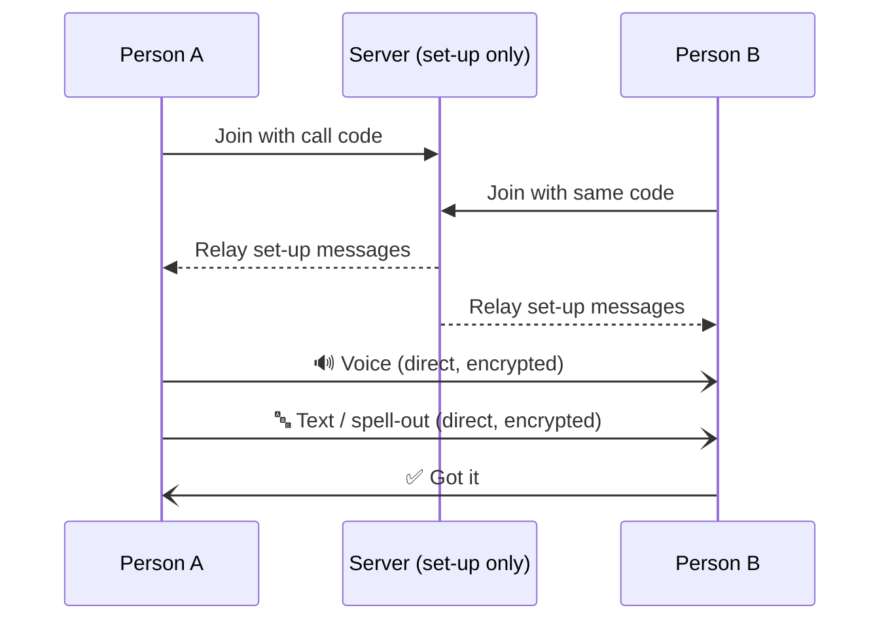

<div align="center">

# 📞 ClearCall

### Never mishear a letter or number on a call again.

Voice calls with built-in text and spell-out, so people can confirm hard-to-hear details **without ending the call or switching apps**.


</div>

---

## 🤔 The problem

A delivery driver calls a customer to confirm the address.

> Customer says **"B-204"**. The driver hears **"D-204"**. Wrong building, wasted trip, unhappy customer.

Letters like **B / D**, **M / N** and **P / T**, and digits like **5 / 9**, are easy to mishear on a weak network or in a noisy street. Today people end the call, switch to a messaging app, and lose time.

## ✨ The solution

ClearCall adds a text layer **inside the call itself**:

| Feature | What it does |
|---|---|
| 🔤 **Spell out** | Type `B204` and the other person instantly sees big tiles: **B** *Bravo* · **2** *Two* · **0** *Zero* · **4** *Four* |
| ✅ **Got it** | The listener taps one button, and the speaker sees *"They confirmed this"* |
| 💬 **Message** | Normal text chat during the call, with no app switching |
| 🎙️ **Voice suggestions** *(experimental)* | Say letters or numbers aloud and ClearCall offers to send them as spelled-out text in one tap |

## 🔒 Privacy and security

- **Voice** is encrypted by WebRTC (DTLS-SRTP) and goes directly between the two phones.
- **Text, spell-out and confirmations** travel over the WebRTC data channel, so they are **end-to-end encrypted** and **never pass through the server**.
- **No database.** Nothing is stored; everything disappears when the call ends.
- ⚠️ The optional *voice suggestions* use Chrome's speech recognition, which sends your speech to Google. On-device recognition is on the roadmap.

## 🧠 How it works



The server only introduces the two phones to each other. After that, voice and text flow directly between them.

## 🧰 Tech stack

| Part | Technology |
|---|---|
| Server | Node.js, Express |
| Call set-up | Socket.IO |
| Voice and text | WebRTC (audio stream and data channel) |
| Front end | Plain HTML, CSS and JavaScript |
| Font | Atkinson Hyperlegible, designed so similar characters are easy to tell apart |
| Voice suggestions | Web Speech API (Chrome) |

## 🚀 Quick start

**Requirements:** [Node.js 18+](https://nodejs.org) and Google Chrome.

```bash
git clone https://github.com/YOUR-USERNAME/clearcall.git
cd clearcall
npm install
npm start
```

Open **http://localhost:3000** in two Chrome windows, enter the same call code (for example `pune42`) in both, allow the microphone, and press **Start call**. Use headphones to avoid echo.

### 📱 Try it on two phones

Browsers only allow the microphone on `https`. While the server is running, open a second terminal:

```bash
# Windows
winget install Cloudflare.cloudflared

cloudflared tunnel --url http://localhost:3000
```

Open the `https://…trycloudflare.com` link it prints on both phones, enter the same code, and start the call.

## 🗂️ Project structure

```
clearcall/
├── server.js          # Express + Socket.IO: call set-up only
├── public/
│   └── index.html     # Call screen, spell-out tiles, voice suggestions
├── package.json
└── README.md
```

## 🛣️ Roadmap

- [x] Voice calling between two people
- [x] In-call messages and spell-out tiles with phonetic words
- [x] "Got it" confirmation
- [x] End-to-end encrypted text over the WebRTC data channel
- [ ] TURN relay server, so calls connect on every network
- [ ] On-device speech recognition (no audio leaves the phone)
- [ ] Deploy to the cloud with a permanent https link
- [ ] Accounts and a database for companies
- [ ] Reusable **SDK** (Android / Flutter) for delivery, ride and support apps
- [ ] Pilot with a delivery or logistics team, measuring failed deliveries and call time

## 🎯 Where it helps

Delivery and logistics · cab pickups · customer support · bank and ID verification · emergency services · anywhere one misheard character causes a problem.

## 👤 Author

Built by **Ayush Bhamare**.
